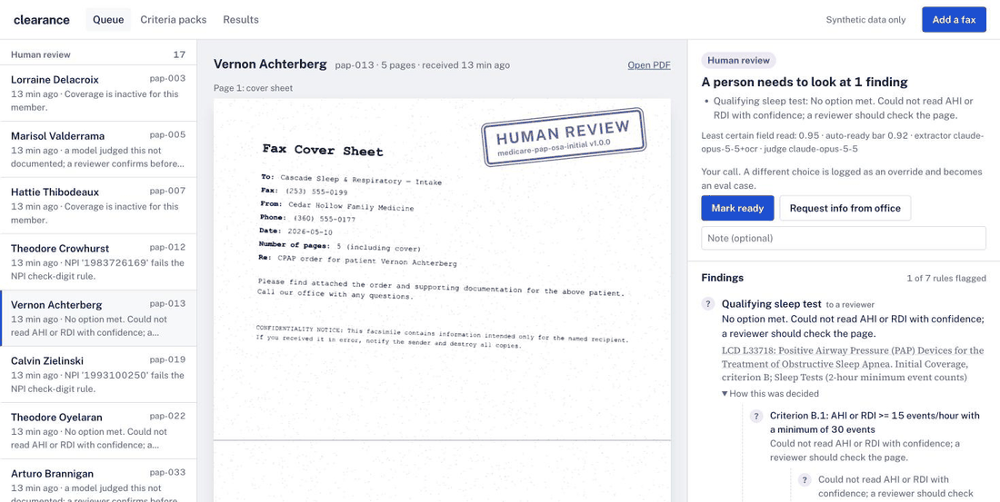

# clearance

**A configurable intake and qualification engine for faxed DME orders.** A referral packet
comes in by fax; fields are extracted, the ordering provider and the patient's coverage
are checked, and the order is tested against Medicare coverage criteria. It comes out
**Ready**, **Needs info** (with a drafted, cited request back to the referring office), or
**Human review**. Onboarding a new item or payer is a YAML *criteria pack*, not a code change.

> [!IMPORTANT]
> **This system never approves or denies coverage.** It flags, cites, and routes; a person
> makes the call. Every patient, provider, and order in this repo is synthetic and every
> page is watermarked `SYNTHETIC – TEST DATA`. Not a production HIPAA system (see
> [what production would need](#what-production-would-need)).



## Quickstart

```bash
uv sync
make serve            # review UI + API at http://127.0.0.1:8000  (API docs at /docs)
make eval             # score the pipeline on 60 synthetic orders -> reports/
make test             # unit tests
```

The UI opens on an empty queue with a **Load sample faxes** button (or run `make eval`,
which also fills the queue). Process your own PDF with **Add a fax**, or from the shell:

```bash
uv run clearance run data/fixtures/pap/pap-015.pdf --pack medicare-pap-osa-initial
uv run clearance packs
uv run clearance check packs/my-new-pack.yaml
```

**No keys needed.** Without any, extraction is local OCR plus the pack's labels and model
checks use an offline keyword judge with the same quote guard. Copy `.env.example` to
`.env` to turn on more:

| Variable | Effect |
|---|---|
| `ANTHROPIC_API_KEY` | Claude answers `llm_judgment` rules (verbatim quote required) |
| `CLEARANCE_EXTRACTOR=claude` | Claude also reads the page images; local OCR cross-checks every field |
| `STEDI_API_KEY` | Stedi **test-mode** eligibility for Stedi's mock members; everyone else uses X12 271 fixtures |
| `CLEARANCE_NPPES_LIVE=0` | Stay offline; unknown NPIs aren't sent to the public NPI Registry |

## How it works

```
fax PDF ─► 1. OCR + page classification (pack-defined document types)
        ─► 2. field extraction against the pack's schema, with per-field confidence
              (local OCR reads by printed labels; Claude vision reads the images;
               two readers that agree earn confidence, disagreement goes to a person)
        ─► 3. rules: deterministic first, then external checks, then model checks
              ├─ ProviderCheck     NPI check digit ─► synthetic roster ─► NPPES (live)
              ├─ EligibilityCheck  Stedi test mode ─► X12 271 fixtures (AAA decoded)
              └─ llm_judgment      answer + verbatim quote, or it's unverifiable
        ─► 4. route: Human review > Needs info > Ready
              (Ready also requires every field a rule used to clear the pack's bar)
        ─► 5. outputs: findings with citations and evidence, outreach fax draft, audit log
```

Precedence is deliberate: a missing defect is worse than a false flag, so anything
unreadable, any failed external check, and any model "not documented" goes to a person,
never straight out the door.

### Criteria packs

A pack is one item × one payer. Every rule cites a source; nested logic is plain YAML.
From [`packs/medicare-pap-osa-initial.yaml`](packs/medicare-pap-osa-initial.yaml):

```yaml
- id: qualifying_sleep_test
  type: any_of
  source: lcd
  cite: "Initial Coverage, criterion B; Sleep Tests (2-hour minimum event counts)"
  on_fail: needs_info
  options:
    - type: all_of        # AHI/RDI >= 15 with >= 30 events
      rules:
        - {type: numeric, field: ahi_or_rdi, op: ">=", value: 15}
        - {type: numeric, field: total_events, op: ">=", value: 30}
    - type: all_of        # AHI/RDI 5-14 with >= 10 events, plus a documented condition
      rules:
        - {type: numeric_range, field: ahi_or_rdi, min: 5, max: 14.99}
        - {type: numeric, field: total_events, op: ">=", value: 10}
        - type: llm_judgment
          question: "Does the record document ... daytime sleepiness, ... hypertension, ... stroke?"
          require_quote: true
```

Rule types: `present`, `present_true`, `pattern`, `in`, `date_order`, `date_window`,
`numeric`, `numeric_range`, `any_of`, `all_of`, `llm_judgment`, `external`. Pack errors are
readable (`rules[3] (qualifying_blood_gas) > numeric: field 'sp02' is not defined in
extraction.fields (did you mean 'spo2'?)`), and the **Criteria packs** page lets you edit
a pack, check it, and run it over the queue to see which orders would change route,
without saving anything.

| Pack | Source | Rules |
|---|---|---|
| `medicare-pap-osa-initial` | LCD L33718 (R11, eff. 2024-01-01), SDR article A55426, CGS checklist | signed order, SWO elements, MBI format, F2F before sleep test, AHI/RDI + event minimums + qualifying condition, NPI, eligibility |
| `medicare-oxygen-home` | LCD L33797 (R11, eff. 2023-04-01), A55426, CGS checklist | Group I rest / exercise-sleep and Group II thresholds on room air, tester not the supplier, test before order, NPI, eligibility |

## Results

Scored by `make eval` against **60 synthetic faxed orders** (40 CPAP, 20 oxygen) at three
fax-degradation levels, with labeled defects planted in ~60% of them. Expected
outcomes come from the generator, never from the engine.

| | CPAP, Claude + OCR | Oxygen, Claude + OCR | CPAP, offline | Oxygen, offline |
|---|---|---|---|---|
| Planted defects flagged (recall) | 100% | 100% | 100% | 100% |
| Defective orders routed Ready | 0 | 0 | 0 | 0 |
| Fields read correctly | 100.0% | 100.0% | 98.8% | 99.1% |
| Page types classified correctly | 100% | 100% | 100% | 100% |
| Routed as expected | 100% | 85% | 82% | 85% |
| Complete orders auto-routed Ready | 20 of 20 | 7 of 10 | 13 of 20 | 7 of 10 |
| Model quotes found verbatim | 100% | 100% | 100% | 100% |
| Median seconds per order, OCR cached | 12.2 | 12.3 | 0.1 | 0.1 |
| Model cost per order | $0.068 | $0.070 | $0.000 | $0.000 |

*Claude + OCR*: `claude-opus-5-5` reads the page images and answers model checks; local OCR cross-checks every field. *Offline*: local OCR and the keyword judge, no API key. Auto-ready bar 0.92 for both packs. Latency is measured with OCR results cached from earlier runs; cold OCR adds about 8–10 s per 5–6 page packet on a laptop CPU (two detection passes at ~1.6 s a page).


**Reading these honestly.** The generator, the templates, and the packs were written by
the same author, so these numbers show the pipeline works end to end. They don't show
real-world accuracy. The figures that matter most are the safety ones, and they hold in
both modes: **every planted defect was flagged, and no defective order was auto-routed
Ready.** When the system is wrong, it is wrong toward a person looking. Full reports:
[`reports/eval_claude.md`](reports/eval_claude.md), [`reports/eval_offline.md`](reports/eval_offline.md).
CI runs the offline eval on every push and fails if a defective order is ever routed Ready.

**Generalization.** Pack #2 (home oxygen) was authored and validated against its 20
fixtures in about 5 minutes of wall-clock (by Claude Code right after building pack #1,
so not a human onboarding estimate). It needed **0 lines of engine code**: the oxygen
logic is YAML only. Onboarding surfaced one generic router bug (missing optional fields
counted as zero confidence), fixed in 2 lines for every pack. The synthetic-data generator
for oxygen fixtures is 259 lines of test tooling.

## Repo layout

```
packs/                   criteria packs (YAML)
clearance/
  engine/                pack schema + loader, rule evaluators, router, LLM judge + quote guard
  extract/               OCR (two-scale RapidOCR), label-driven extractor, Claude vision cross-check
  integrations/          npi.py (Luhn + NPPES), eligibility.py (Stedi + fixtures), x12_decode.py
  outreach/              missing-items fax template + renderer
  api/                   FastAPI app + file-backed order store and audit log
  synth/                 synthetic patients, templated packets, fax degradation, ground truth
  eval/                  harness, metrics, threshold sweep, reports
ui/                      review UI (plain HTML/CSS/JS, no build step)
data/fixtures/           60 rendered packets + X12 271 eligibility fixtures
data/ground_truth/       expected fields, rule outcomes, and route per order
docs/                    implementation kit (md/pdf), deck, build script
reports/                 latest eval reports and threshold charts
```

## Integrations

* **NPPES NPI Registry** (live, keyless, cached on disk): active status, individual vs.
  organization, rough name match. Synthetic providers resolve from a local roster first,
  so no clinical content is ever attached to a real clinician's NPI.
* **Stedi eligibility, test mode:** JSON API for Stedi's documented mock members (Medicare:
  Jane Doe, MBI `1AA2CC3DD45`). Test mode only answers for those, so every other synthetic
  patient resolves from a recorded X12 271 whose `EB` status and `AAA` reject codes are
  decoded by `x12_decode.py`.
* Both sit behind `ProviderCheck` / `EligibilityCheck` protocols, so a customer's own
  system (a Brightree eligibility export, an EHR directory) slots in without rule changes.

## Implementation kit

[`docs/implementation_kit.pdf`](docs/implementation_kit.pdf) (source:
[`.md`](docs/implementation_kit.md)) works the Enterprise SE half for a fictional customer,
*Cascade Sleep & Respiratory*: discovery and operational audit, solution design, a
business case whose measured inputs are pulled from the latest eval by `docs/build.py`,
and a phased rollout (shadow → auto-route Ready → outreach drafts → more packs). Slides:
[`docs/deck.html`](docs/deck.html).

## What production would need

* **BAA-covered model hosting** (Anthropic API under a BAA, or Claude on a BAA-covered
  cloud), and no PHI in logs, prompts kept server-side.
* **Access control** (SSO, roles for coordinator vs. reviewer vs. pack author) and
  **encryption at rest** for packets, decisions, and the audit log.
* **Audit retention** that meets HIPAA and payer audit windows; the append-only
  `audit.jsonl` here is the shape, not the store.
* **Pack governance:** versioned packs signed off by a DME billing lead, with the eval run
  against the customer's own labeled orders before each version goes live.
* **A real fax and EHR boundary:** fax-line ingestion, Brightree (or equivalent) export,
  retries and idempotency.

## Known limitations

* The model check reads OCR text so its quote can be verified. If OCR drops a line, the
  judge can't quote it and the order goes to a reviewer (2 of 20 oxygen orders in Claude
  mode). Safe, but it costs automation.
* The confidence bar (0.92) was calibrated on 40 synthetic orders. Phase 0 shadow mode on
  real faxes exists to set it properly.
* doc-router was not run (no Docker on the build machine); the `Extractor` interface is
  where it would plug in. See [NOTICE.md](NOTICE.md) for what was reused from upstream.

Built with Python 3.12, FastAPI, Claude, RapidOCR, NPPES, and Stedi. Upstream credits in
[NOTICE.md](NOTICE.md).
