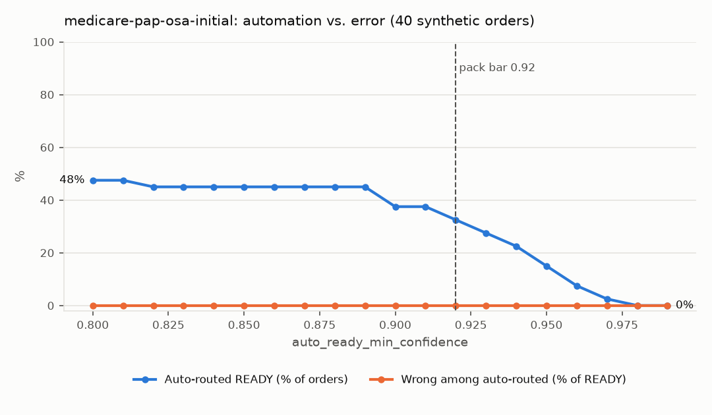
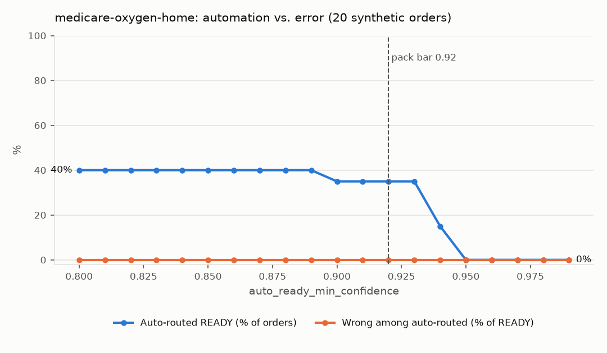

# Evaluation report — 2026-10-26

All orders are synthetic (`SYNTHETIC – TEST DATA`). Expected outcomes come from planted defects in the generator, not from the engine.

## medicare-pap-osa-initial v1.0.0 (40 orders)

Models: extractor `ocr-rules`, judge `offline-keyword`. Auto-ready threshold 0.92.

| Metric | Value |
|---|---|
| Field extraction accuracy | 98.8% |
| … on clean faxes | 99.4% |
| … on heavy faxes | 99.5% |
| … on light faxes | 97.6% |
| Page classification accuracy | 100.0% |
| Defect recall (all rules) | 100.0% |
| Routing accuracy | 82.5% |
| Orders wrongly auto-routed READY | 0  |
| LLM-judgment quotes found verbatim | 100.0% (6 quotes) |
| Latency p50 / p95 | 0.05s / 0.07s |
| Model cost per order | $0.0000 |

### Per-rule precision / recall (positive = rule should flag)

| Rule | TP | FP | FN | Precision | Recall |
|---|---|---|---|---|---|
| `order_signed` | 4 | 1 | 0 | 80.0% | 100.0% |
| `order_elements` | 0 | 0 | 0 | n/a | n/a |
| `mbi_format` | 0 | 0 | 0 | n/a | n/a |
| `f2f_before_test` | 7 | 0 | 0 | 100.0% | 100.0% |
| `qualifying_sleep_test` | 8 | 1 | 0 | 88.9% | 100.0% |
| `provider_active` | 3 | 0 | 0 | 100.0% | 100.0% |
| `coverage_active` | 3 | 0 | 0 | 100.0% | 100.0% |

### Routing confusion matrix (rows = expected)

| expected \ got | ready | needs_info | human_review |
|---|---|---|---|
| ready | 13 | 0 | 7 |
| needs_info | 0 | 9 | 0 |
| human_review | 0 | 0 | 11 |

### Field accuracy by field

| Field | Accuracy |
|---|---|
| `patient_name` | 100.0% |
| `patient_dob` | 100.0% |
| `medicare_id` | 100.0% |
| `ordering_provider_name` | 100.0% |
| `ordering_npi` | 100.0% |
| `item_ordered` | 100.0% |
| `order_date` | 100.0% |
| `order_signed` | 97.5% |
| `f2f_date` | 100.0% |
| `sleep_test_date` | 100.0% |
| `sleep_test_type` | 87.5% |
| `ahi_or_rdi` | 100.0% |
| `total_events` | 100.0% |

### Automation rate vs. threshold

| Threshold | Auto-routed | Wrong among auto-routed | READY recall |
|---|---|---|---|
| 0.80 | 47.5% | 0.0% | 95.0% |
| 0.81 | 47.5% | 0.0% | 95.0% |
| 0.82 | 45.0% | 0.0% | 90.0% |
| 0.83 | 45.0% | 0.0% | 90.0% |
| 0.84 | 45.0% | 0.0% | 90.0% |
| 0.85 | 45.0% | 0.0% | 90.0% |
| 0.86 | 45.0% | 0.0% | 90.0% |
| 0.87 | 45.0% | 0.0% | 90.0% |
| 0.88 | 45.0% | 0.0% | 90.0% |
| 0.89 | 45.0% | 0.0% | 90.0% |
| 0.90 | 37.5% | 0.0% | 75.0% |
| 0.91 | 37.5% | 0.0% | 75.0% |
| 0.92 | 32.5% | 0.0% | 65.0% |
| 0.93 | 27.5% | 0.0% | 55.0% |
| 0.94 | 22.5% | 0.0% | 45.0% |
| 0.95 | 15.0% | 0.0% | 30.0% |
| 0.96 | 7.5% | 0.0% | 15.0% |
| 0.97 | 2.5% | 0.0% | 5.0% |
| 0.98 | 0.0% | 0.0% | 0.0% |
| 0.99 | 0.0% | 0.0% | 0.0% |

### Misses

- `pap-004` (clean, defects: none): expected **ready**, got **human_review**
- `pap-006` (heavy, defects: none): expected **ready**, got **human_review**
- `pap-010` (clean, defects: none): expected **ready**, got **human_review**
- `pap-022` (heavy, defects: illegible_ahi): expected **human_review**, got **human_review**; field errors: order_signed; rule mismatches: order_signed pass→fail
- `pap-027` (heavy, defects: none): expected **ready**, got **human_review**
- `pap-028` (clean, defects: mild_buried_symptom): expected **ready**, got **human_review**
- `pap-030` (heavy, defects: none): expected **ready**, got **human_review**
- `pap-031` (clean, defects: mild_buried_symptom): expected **ready**, got **human_review**; rule mismatches: qualifying_sleep_test pass→fail

## medicare-oxygen-home v1.0.0 (20 orders)

Models: extractor `ocr-rules`, judge `offline-keyword`. Auto-ready threshold 0.92.

| Metric | Value |
|---|---|
| Field extraction accuracy | 99.1% |
| … on clean faxes | 98.2% |
| … on heavy faxes | 100.0% |
| … on light faxes | 99.1% |
| Page classification accuracy | 100.0% |
| Defect recall (all rules) | 100.0% |
| Routing accuracy | 85.0% |
| Orders wrongly auto-routed READY | 0  |
| LLM-judgment quotes found verbatim | 100.0% (1 quotes) |
| Latency p50 / p95 | 0.05s / 0.06s |
| Model cost per order | $0.0000 |

### Per-rule precision / recall (positive = rule should flag)

| Rule | TP | FP | FN | Precision | Recall |
|---|---|---|---|---|---|
| `order_signed` | 1 | 0 | 0 | 100.0% | 100.0% |
| `order_elements` | 0 | 1 | 0 | 0.0% | n/a |
| `mbi_format` | 0 | 0 | 0 | n/a | n/a |
| `qualifying_blood_gas` | 5 | 1 | 0 | 83.3% | 100.0% |
| `qualified_tester` | 2 | 1 | 0 | 66.7% | 100.0% |
| `test_before_order` | 1 | 0 | 0 | 100.0% | 100.0% |
| `provider_active` | 1 | 0 | 0 | 100.0% | 100.0% |
| `coverage_active` | 0 | 0 | 0 | n/a | n/a |

### Routing confusion matrix (rows = expected)

| expected \ got | ready | needs_info | human_review |
|---|---|---|---|
| ready | 7 | 1 | 2 |
| needs_info | 0 | 7 | 0 |
| human_review | 0 | 0 | 3 |

### Field accuracy by field

| Field | Accuracy |
|---|---|
| `patient_name` | 100.0% |
| `patient_dob` | 100.0% |
| `medicare_id` | 100.0% |
| `ordering_provider_name` | 100.0% |
| `ordering_npi` | 100.0% |
| `item_ordered` | 95.0% |
| `order_date` | 100.0% |
| `order_signed` | 100.0% |
| `test_date` | 100.0% |
| `test_condition` | 100.0% |
| `on_room_air` | 100.0% |
| `spo2` | 100.0% |
| `po2` | 100.0% |
| `baseline_spo2` | 100.0% |
| `test_performer` | 90.0% |
| `hematocrit` | 100.0% |

### Automation rate vs. threshold

| Threshold | Auto-routed | Wrong among auto-routed | READY recall |
|---|---|---|---|
| 0.80 | 40.0% | 0.0% | 80.0% |
| 0.81 | 40.0% | 0.0% | 80.0% |
| 0.82 | 40.0% | 0.0% | 80.0% |
| 0.83 | 40.0% | 0.0% | 80.0% |
| 0.84 | 40.0% | 0.0% | 80.0% |
| 0.85 | 40.0% | 0.0% | 80.0% |
| 0.86 | 40.0% | 0.0% | 80.0% |
| 0.87 | 40.0% | 0.0% | 80.0% |
| 0.88 | 40.0% | 0.0% | 80.0% |
| 0.89 | 40.0% | 0.0% | 80.0% |
| 0.90 | 35.0% | 0.0% | 70.0% |
| 0.91 | 35.0% | 0.0% | 70.0% |
| 0.92 | 35.0% | 0.0% | 70.0% |
| 0.93 | 35.0% | 0.0% | 70.0% |
| 0.94 | 15.0% | 0.0% | 30.0% |
| 0.95 | 0.0% | 0.0% | 0.0% |
| 0.96 | 0.0% | 0.0% | 0.0% |
| 0.97 | 0.0% | 0.0% | 0.0% |
| 0.98 | 0.0% | 0.0% | 0.0% |
| 0.99 | 0.0% | 0.0% | 0.0% |

### Misses

- `oxy-013` (clean, defects: none): expected **ready**, got **needs_info**; field errors: item_ordered; rule mismatches: order_elements pass→fail
- `oxy-014` (light, defects: none): expected **ready**, got **human_review**
- `oxy-019` (clean, defects: group2_with_condition): expected **ready**, got **human_review**; field errors: test_performer; rule mismatches: qualifying_blood_gas pass→fail, qualified_tester pass→fail
